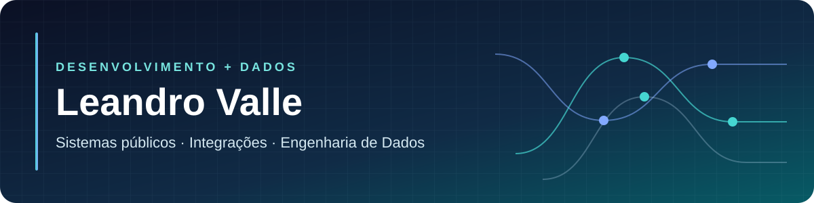

  

**Desenvolvedor full stack com experiência prática em dados e foco crescente em Engenharia de Dados.**

---

## Olá, eu sou o Leandro 👋

Sou desenvolvedor full stack com experiência prática em engenharia de dados, migração e integração de sistemas. Trabalho com tecnologia para o setor público, em áreas como saúde, educação, assistência social, folha de pagamento, compras públicas e transporte escolar. Estou direcionando minha carreira para Engenharia de Dados.

Gosto de entender a operação antes de escrever código. No dia a dia, analiso bases legadas, extraio e transformo dados, valido cargas, integro plataformas por API e modernizo aplicações em produção.

## O que faço

| Área | Como atuo |
| :--- | :--- |
| **Sistemas web** | Desenvolvimento e evolução de aplicações para rotinas operacionais. |
| **Integrações** | APIs, validação de dados e tratamento de falhas entre plataformas. |
| **Engenharia de Dados** | Extração, transformação, qualidade, migração, conferência e reprocessamento de dados. |
| **Modernização** | Evolução gradual de sistemas legados em produção. |

## Tecnologias e ferramentas

  
  &nbsp;
  &nbsp;
  &nbsp;
  &nbsp;
  &nbsp;
  &nbsp;

- **Back-end:** C#, .NET, ASP.NET Core, ASP.NET MVC, Entity Framework Core, Dapper
- **Dados e automação:** SQL Server, Python, Pentaho Data Integration, Jupyter, ETL
- **Front-end:** JavaScript, HTML, CSS, Bootstrap
- **Fluxo de trabalho:** Git, APIs REST

## Experiência aplicada em dados

- **Saúde:** migração de dados do e-SUS APS e de sistemas legados para uma plataforma em nuvem, com mapeamento de campos, transformação, validação, carga por API, prevenção de duplicidades e conferência dos resultados.
- **Educação:** integração de dados acadêmicos e cadastrais com a Secretaria Escolar Digital (SED), usando Pentaho, Python e Jupyter para preparar e validar as informações.
- **Folha de pagamento:** análise de bases legadas, regras de migração, consultas SQL, padronização, tratamento de inconsistências e validação das cargas.

## Projetos em destaque

### [eSUS Data Platform Lab — arquitetura Lakehouse para APS](https://github.com/LeandroAValle/esus-data-platform-lab)

Meu laboratório de Engenharia de Dados em desenvolvimento. O repositório contém implementação de ingestão PostgreSQL, Bronze Delta Lake, Silver PySpark, **7 modelos Gold em dbt/DuckDB**, DAG Airflow, dashboard Streamlit e exportação Parquet. A vitrine separa código presente de tecnologias ainda planejadas.

[**Explorar o código e as decisões**](https://github.com/LeandroAValle/esus-data-platform-lab) · [**Visualizar a arquitetura**](https://leandroavalle.github.io/esus-data-platform-lab/)

### Outros projetos para explorar

| Projeto | O que demonstra | Acesso |
| :--- | :--- | :--- |
| [DataAPS Demo](https://github.com/LeandroAValle/dataaps-demo) | Python ETL, FastAPI, React e indicadores APS com dados fictícios | [Demo](https://leandroavalle.github.io/dataaps-demo/) |
| [Migrador Folha Demo](https://github.com/LeandroAValle/migrador-folha-demo) | Python, validação, trilha por registro e conciliação | [Demo](https://leandroavalle.github.io/migrador-folha-demo/) |
| [Migrador Saúde Demo](https://github.com/LeandroAValle/migrador-saude-demo) | Guard de escrita, ledger e confirmação do resultado por item | [Demo](https://leandroavalle.github.io/migrador-saude-demo/) |
| [e-SUS ETL Flow](https://github.com/LeandroAValle/esus-etl-flow-demo) | Mapa interativo das dependências de ETL, sem arquivos operacionais | [Mapa](https://leandroavalle.github.io/esus-etl-flow-demo/) |
| [SocialWeb Demo](https://github.com/LeandroAValle/socialweb-demo) | API .NET, indicadores por território e painel de gestão social | [Demo](https://leandroavalle.github.io/socialweb-demo/) |

Todos os demos públicos usam dados fictícios ou metadados de arquitetura. Os sistemas operacionais e suas credenciais permanecem privados.

## Formação e aprendizado contínuo

- Formação no **Centro Universitário de Rio Preto**.
- **Engenharia de Dados com IA** — Alura, 2026.
- **Imersão Profissional Jornada de Dados** — Jornada de Dados, 2026.
- **Masterclass Building IA Products** — Alura, 2026.

Minha trajetória combina desenvolvimento de sistemas com trabalho direto em dados reais. Estou aprofundando essa base para atuar cada vez mais em engenharia de dados, qualidade e integração de informações.

## Como penso sobre software

> Código bom começa com uma regra de negócio bem compreendida.

Em sistemas públicos, uma integração falha ou um cálculo incorreto pode afetar diretamente o atendimento e a vida das pessoas. Por isso, valorizo clareza, validação e evolução cuidadosa de sistemas em uso.

## Vamos conversar?

[LinkedIn](https://www.linkedin.com/in/leandro-valle-68573a140/) · [Repositórios](https://github.com/LeandroAValle?tab=repositories)
